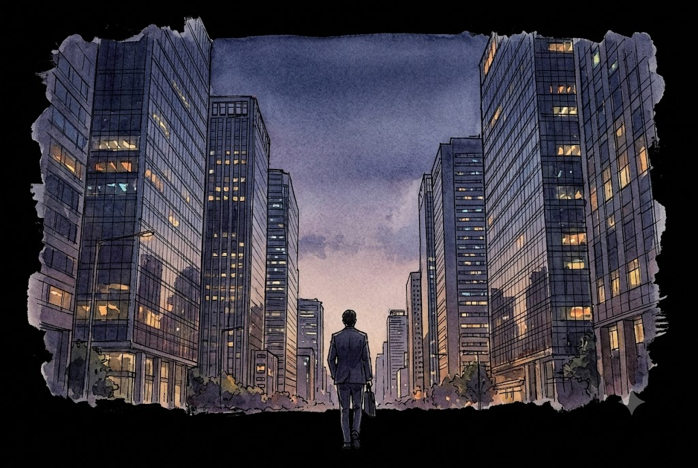
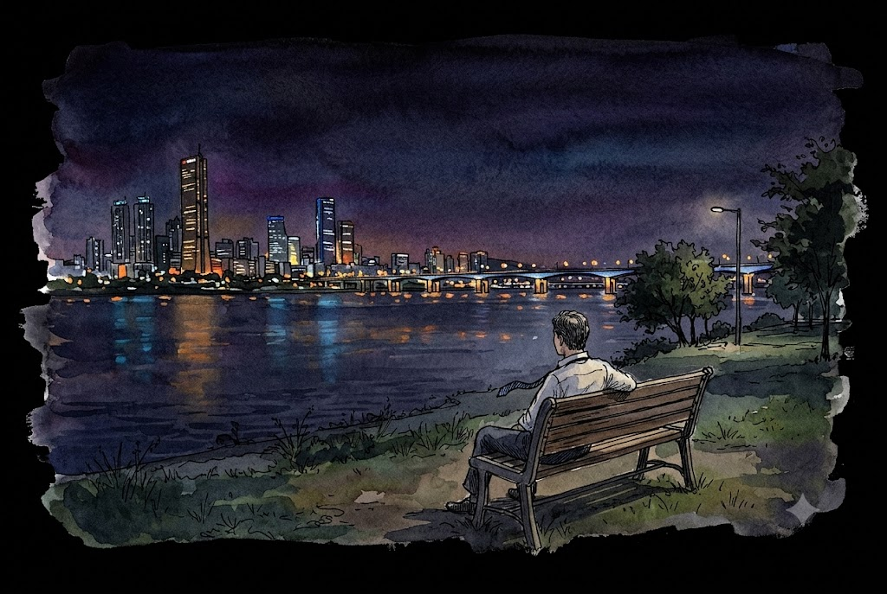

> ✅ **Spoiler-free.** This post covers the setup and the first few episodes only. No ending talk.

Some K-dramas have zombies. Some have time travel. Some have a chaebol heir who falls in love with a waitress.

*The Dream Life of Mr. Kim* has a 52-year-old sales manager who is worried about his next promotion.

That's it. And somehow, it became one of the most talked-about Korean dramas of the past year. It started small. It ended big. And in May 2026, its lead actor walked away with the biggest TV prize in Korea.

So what is going on here? Let's unpack it.

---

## First, the Weird Title

The Korean title is long. Really long. Translated word by word, it says:

**"The Story of Manager Kim, Who Owns His Own Home in Seoul and Works for a Big Company."**

To most global viewers, that sounds like a strange way to name a show. To Korean viewers, it sounds like a punchline. Here is why.

In Korea, there is an unspoken checklist for a "successful" middle-class life. Two items sit at the very top:

| The Checklist Item | Why It Matters in Korea |
|:---|:---|
| **A big company job (대기업)** | Big firms pay more, look better, and make parents proud. Getting in is very hard. |
| **Your own apartment in Seoul (서울 자가)** | Seoul home prices are extremely high. Owning one — not renting — is a huge status symbol. |
| **The title "Bujang" (부장)** | A senior manager rank. It means you survived 20+ years of office life. |

Mr. Kim has all three. On paper, he "won."

The director, Cho Hyun-tak, said he knew the title would make people feel two different things. Some viewers feel a little uneasy, because few people can actually reach that level. Others shrug and say, "Well, that's just what middle class means now." That tension is the whole engine of the show.

The title is not bragging. It is a setup. The drama is asking one quiet question: **What happens when the checklist is the only thing holding your life together?**

---

## The Basics

| | |
|:---|:---|
| **Korean title** | 서울 자가에 대기업 다니는 김 부장 이야기 |
| **Network** | JTBC (Korea) / Netflix (global) |
| **Aired** | October 25 – November 30, 2025 |
| **Episodes** | 12 |
| **Director** | Cho Hyun-tak (*SKY Castle*) |
| **Writers** | Kim Hong-ki, Yoon Hye-sung |
| **Based on** | The hit web novel by Song Hee-gu |
| **Music** | Jung Jae-hyung |

> 💡 **Don't mix it up!** In summer 2026, SBS aired a totally different show called *Kim Bujang* (김부장), an action thriller starring So Ji-sub. Same rank, very different man. This post is about the JTBC drama with Ryu Seung-ryong.

---

## Meet Mr. Kim (and His Family)

**Kim Nak-soo** (Ryu Seung-ryong) has worked in sales at a company called ACT for 25 years. He has never missed a promotion. He has the apartment. He has the car. He has the nice watch. He also has opinions — lots of them — about how young workers should behave.

He is, in Korean slang, a little bit of a **kkondae** (꼰대). That means an older person who lectures others and thinks "the old way" is always right. The show is not afraid to make him look silly. In the early episodes, you will laugh *at* him a lot.

| Character | Actor | Who They Are |
|:---|:---|:---|
| Kim Nak-soo | Ryu Seung-ryong | 25-year sales veteran, proud manager |
| Park Ha-jin | Myung Se-bin | His wife, calm and sharp |
| Kim Su-gyeom | Cha Kang-yoon | Their son, unsure about his future |
| Baek Jeong-tae | Yoo Seung-mok | The executive Nak-soo looks up to like a big brother |
| Do Jin-woo | Lee Shin-ki | A fellow manager and rival |

But then things start to slip. His boss looks at him a little differently. A younger coworker moves ahead. The "big brother" executive gets harder to read. By episode 4, the ground under Mr. Kim begins to shake — and the comedy slowly turns into something heavier.

That's all we'll say. The rest is the journey.

*25 years of the same commute. The same tower. The same title.*

---

## Why Korea Felt This One in the Chest

A drama about a middle-aged office guy is not an easy sell. Ryu Seung-ryong himself said it later: a story about a man in his 50s who falls from the top is the kind of thing TV usually ignores.

So why did it work? The Editor sees three reasons.

### 1. The "early exit" fear is real

In many big Korean companies, the 50s are a scary decade. You are senior and expensive. Promotion spots at the top are few. Many long-time workers face pressure to step aside — sometimes through "honorary retirement" (명예퇴직), a polite name for being nudged out with a payout.

So when Mr. Kim's position starts to wobble, Korean viewers did not see fiction. They saw their dad. Their uncle. Their boss. Sometimes themselves. That is why workers in their 40s and 50s didn't just watch this show — they felt seen by it. (The Editor is one of them. More on that below.)

### 2. It is not just about dads

Here is the smart part. The show gives real weight to the wife and the son, too.

Ha-jin is not a background "supportive wife." She has her own worries and her own plans. Su-gyeom is a young man who doesn't know what he wants to do — a feeling many Korean twenty-somethings know very well. The director said he worried younger viewers would not care about a 50-something hero. His answer was to show that Mr. Kim's story is someone's past, and someone else's future.

### 3. It is funny first, sad later

The early episodes play like an office comedy. Mr. Kim gives long speeches nobody wants. He tries way too hard to look important. You laugh.

Then the jokes stop landing the way he wants them to. And you notice you are not laughing anymore. That slow shift is why so many viewers said the show "sneaks up on you."

---

## The Numbers Tell a Comeback Story

Most dramas start strong and fade. This one did the opposite.

| Episode | Nationwide Rating (Nielsen Korea) |
|:---|:---|
| Episode 1 | 2.9% |
| Episode 10 | 5.4% |
| Episode 12 (finale) | **7.6%** (series high) |

Those numbers may look small next to a big network hit. But for a weekend cable drama about a tired office worker, more than doubling your audience is a big deal. Viewers found it late, told their friends, and kept coming back.

---

## The Awards

At the **62nd Baeksang Arts Awards** (May 8, 2026), the show had a very good night:

| Award | Winner |
|:---|:---|
| **Grand Prize (Daesang), TV** | Ryu Seung-ryong |
| **Best Supporting Actor, TV** | Yoo Seung-mok |

This was Ryu's second Baeksang Grand Prize. His first came for the film *Miracle in Cell No. 7*. It was also his first regular TV-network drama in about 15 years — he had mostly worked in movies and streaming shows like *Kingdom* and *Moving*.

If you only know him as the loud, funny chief from [Extreme Job](/posts/extreme-job-part3-cast/), this role will surprise you. Same face. Very different man.

*Some nights, the title on your business card feels very heavy.*

---

## The Editor's Note

> *A personal note from the Editor.*
>
> This show gave real comfort to Korean office workers in their 40s and 50s. I am one of them. I am in my 40s, and I enjoyed every single episode.
>
> I have spent about 20 years inside a big company. Monday to Friday. 8 a.m. to 6 p.m. Ten hours a day in the same chair. Some days, a quiet thought sneaks up on me: *Most of my life is happening right here.*
>
> Is it worth it? I would be working hard, giving my best, and then suddenly stop and wonder. Is this the right road? Are these the right years to spend this way?
>
> I may have about ten more years left. I know they will fly by, just like the last twenty did. If I could look back on thirty years at one company and truly feel they were worth it — that they were good years, years I am thankful for — how happy would that be?
>
> But the truth is, I always feel a little uneasy. My heart feels heavy. There is the weight of taking care of my family. There is the promise I made to myself not to fall down on this road. There is the duty to do well at the work people trust me with. All of it gets tangled together. And when I ask what will be left at the end of all these busy days, the unease slowly turns into fear.
>
> In that fear, I wanted to hear from the people who walked this road before me. But many of them left quietly, and a little lonely. Somehow, calling them felt even scarier.
>
> That is what this drama became for me. Through Mr. Kim, it felt like one of those seniors finally sat down beside me and told me his story. It told me my worry and fear were not mine alone. The people ahead of me crossed the same rough field in their hearts. And somewhere on the other side, they found a new kind of calm — and a new kind of happiness.

---

## Who Should Watch It?

**Watch it if you:**
- Loved the quiet, grown-up feeling of [My Mister](/posts/my-mister-deep-dive/)
- Like slow-burn stories more than big plot twists
- Are curious about real Korean office and family life
- Want to see one of Korea's best actors at his best

**Maybe skip it if you:**
- Need romance, action, or a villain to stay hooked
- Want a fast pace from episode 1 (give it until episode 4)

[**▶ Watch 'The Dream Life of Mr. Kim' Official Trailer on YouTube**](https://www.youtube.com/results?search_query=The+Dream+Life+of+Mr.+Kim+Official+Trailer)

[**▶ Watch Ryu Seung-ryong's Baeksang 2026 Grand Prize Speech on YouTube**](https://www.youtube.com/results?search_query=류승룡+백상예술대상+대상+소감)

---

## Final Verdict

*The Dream Life of Mr. Kim* is not loud. It does not have a shocking twist in episode 1. What it has is honesty. It looks at the "perfect" Korean middle-class life — the Seoul apartment, the big company, the senior title — and gently asks if any of it was ever the point.

It is funny. Then it is painful. Then, quietly, it is kind.

**Rating: 8.8 / 10**

---

### Read More on K-Unpacked
- [My Mister: The Editor's Masterpiece Walk](/posts/my-mister-deep-dive/) — another K-drama about tired adults and quiet kindness
- [Extreme Job Cast & Creators](/posts/extreme-job-part3-cast/) — see Ryu Seung-ryong in full comedy mode
- [The Top 10 K-Dramas on Netflix](/posts/kdrama-top10-part1-rankings/) — where the global hits stand

*Data: Nielsen Korea (nationwide, paid households) via TenAsia and TV Report; 62nd Baeksang Arts Awards results via Newsis and Xportsnews; production details from JTBC press materials.*
